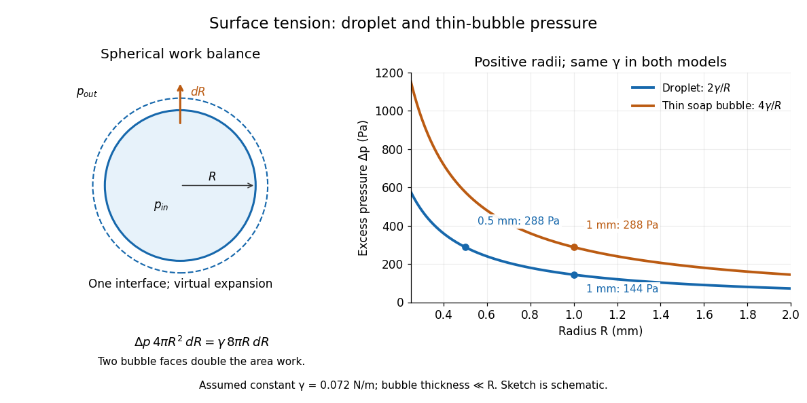

<h1 id="young-laplace-equation">Young–Laplace equation</h1>

↑ **Parent:** [Surface tension](surface-tension.md)  
ⓦ [Wiki](https://en.wikipedia.org/wiki/Young–Laplace_equation)

The [Young–Laplace equation](young-laplace-equation.md) relates the [pressure](pressure.md) jump across a stationary interface to its [curvature](curvature.md) and [surface tension](surface-tension.md). Choose a unit [normal vector](normal-vector.md) $\mathbf n$ pointing from the inside region to the outside region, and define $\kappa=\nabla_s\cdot\mathbf n$ to be positive for a convex [sphere](sphere.md). In mechanical [equilibrium](equilibrium-point-of-a-dynamical-system.md), with constant [surface tension](surface-tension.md) and no additional normal [viscous stresses](viscous-stress-tensor.md),

$$
\Delta p=p_{\mathrm{in}}-p_{\mathrm{out}}
=\gamma\kappa=\gamma(k_1+k_2).
$$

Here $k_1,k_2$ are the signed [principal curvatures](principal-curvature.md) in this convention. Their sum is twice the corresponding signed [mean curvature](mean-curvature.md); stating the convention prevents a factor-of-two ambiguity. The [Young–Laplace equation](young-laplace-equation.md) is a local [normal stress](normal-stress.md) balance for one interface. [Tomas Bohr and Bernhard Scheichl, Surface Tension and Energy Conservation in a Moving Fluid, equations (8)–(9)](https://arxiv.org/html/2011.11403v2)

A spherical [liquid](liquid.md) droplet of [radius](radius.md) $R$ in a [gas](gas.md) has one interface, with $k_1=k_2=1/R$. An ideal thin soap bubble has two [liquid](liquid.md)–[gas](gas.md) interfaces. Adding their [pressure](pressure.md) jumps gives

$$
\Delta p_{\mathrm{droplet}}=\frac{2\gamma}{R},\qquad
\Delta p_{\mathrm{soap\ bubble}}\simeq\frac{4\gamma}{R}.
$$

For the soap bubble, $\Delta p$ now means the inner [gas](gas.md) [pressure](pressure.md) minus the outer [gas](gas.md) [pressure](pressure.md). The second formula assumes equal [surface tensions](surface-tension.md) on both faces and film thickness negligible relative to $R$, so their radii can be identified. Retaining distinct radii gives $2\gamma/R_{\mathrm{inner}}+2\gamma/R_{\mathrm{outer}}$. A [gas](gas.md) bubble inside bulk [liquid](liquid.md) has only one interface and therefore uses $2\gamma/R$. [OpenStax, College Physics 2e, §11.8: pressure in a soap bubble](https://openstax.org/books/college-physics-2e/pages/11-8-cohesion-and-adhesion-in-liquids-surface-tension-and-capillary-action)

With the assumed constant toy [surface tension](surface-tension.md) $\gamma=0.072\,\mathrm{N\,m^{-1}}$, a droplet with $R=1\,\mathrm{mm}$ has excess [pressure](pressure.md) $144\,\mathrm{Pa}$; at $R=0.5\,\mathrm{mm}$ it has $288\,\mathrm{Pa}$. A thin soap bubble assigned the same $\gamma$ and $R=1\,\mathrm{mm}$ has excess [pressure](pressure.md) $288\,\mathrm{Pa}$. These are differences from the surrounding [pressure](pressure.md), rather than absolute [pressures](pressure.md). Halving the [radius](radius.md) doubles the [capillary pressure](capillary-pressure.md); doubling the interface count also doubles it at fixed [radius](radius.md) and [surface tension](surface-tension.md).

**[Figure 20](#image-smaller-droplets-need-larger-excess-pressure-two-bubble-interfaces-double-it). Smaller droplets need larger excess pressure; two bubble interfaces double it**. Left: a virtual outward displacement $dR$ of a [sphere](sphere.md) balances [pressure](pressure.md) [work](work.md) against increased [surface energy](surface-energy.md). Right: excess [pressure](pressure.md) in pascals versus positive [radius](radius.md) in millimetres for one and two interfaces, using the assumed constant toy $\gamma=0.072\,\mathrm{N\,m^{-1}}$.

The spherical case has a short [work](work.md) argument. A virtual increase in [radius](radius.md) gives $dV=4\pi R^2\,dR$ and $dA=8\pi R\,dR$. At mechanical [equilibrium](equilibrium-point-of-a-dynamical-system.md), the net [pressure](pressure.md) [work](work.md) balances the increase in [surface energy](surface-energy.md):

$$
\underbrace{\Delta p\,4\pi R^2\,dR}_{\text{pressure work}}
=\underbrace{\gamma\,8\pi R\,dR}_{\text{surface energy increase}}
\quad\Longrightarrow\quad \Delta p=\frac{2\gamma}{R}.
$$

For a thin soap bubble, both interfaces gain approximately the same [surface area](surface-area.md), doubling the right-hand side and giving $4\gamma/R$. This is a virtual [work](work.md) balance between neighboring spherical configurations, rather than an assumption that a fixed-[volume](volume.md) droplet actually expands. The general [Young–Laplace equation](young-laplace-equation.md) replaces the spherical area-to-[volume](volume.md) ratio by local [curvature](curvature.md), making geometry directly measurable through [pressure](pressure.md).

**Table of contents**

- [Gibbs--Thomson relation](gibbs-thomson-relation.md)
  - [Curvature-induced melting-temperature depression](curvature-induced-melting-temperature-depression.md)

## ↑ Ancestors (5)

1. [Surface tension](surface-tension.md)
2. [Fluid mechanics](fluid-mechanics-split.md)
3. [Branches of physics](branches-of-physics.md)
4. [Physics](physics-split.md)
5. [Codex Wiki](split.md)

## ← Incoming links (28)

- [Annular viscous extension](annular-viscous-extension.md)
- [Capillary pressure](capillary-pressure.md)
- [Capillary tensile force of a slender thread](capillary-tensile-force-of-a-slender-thread.md)
- [Capillary wave](capillary-wave.md)
- [Chemical potential of a composition field](chemical-potential-of-a-composition-field.md)
- [Clausius-Clapeyron relation](clausius-clapeyron-relation.md)
- [Gravity-capillary wave](gravity-capillary-wave.md)
- [Solution](past-exam-of-the-mathematics-course-of-the-university-of-cambridge/2001/iii/paper-44/3/solution.md)
- [Solution](past-exam-of-the-mathematics-course-of-the-university-of-cambridge/2004/iii/paper-74/4/solution.md)
- [Solution](past-exam-of-the-mathematics-course-of-the-university-of-cambridge/2005/iii/paper-81/4/i/solution.md)
- [Solution](past-exam-of-the-mathematics-course-of-the-university-of-cambridge/2010/iii/paper-66/3/solution.md)
- [Solution](past-exam-of-the-mathematics-course-of-the-university-of-cambridge/2014/iii/paper-73/4/solution.md)
- [Solution](past-exam-of-the-mathematics-course-of-the-university-of-cambridge/2017/iii/paper-329/2/a/solution.md)
- [Solution](past-exam-of-the-mathematics-course-of-the-university-of-cambridge/2017/iii/paper-329/2/b/solution.md)
- [Solution](past-exam-of-the-mathematics-course-of-the-university-of-cambridge/2018/ib/paper-3/18d/solution.md)
- [Solution](past-exam-of-the-mathematics-course-of-the-university-of-cambridge/2018/iii/paper-331/1/a/iii/solution.md)
- [Solution](past-exam-of-the-mathematics-course-of-the-university-of-cambridge/2019/iii/paper-344/3/b/solution.md)
- [Solution](past-exam-of-the-mathematics-course-of-the-university-of-cambridge/2021/iii/paper-329/1/solution.md)
- [Solution](past-exam-of-the-mathematics-course-of-the-university-of-cambridge/2021/iii/paper-332/1/solution.md)
- [Solution](past-exam-of-the-mathematics-course-of-the-university-of-cambridge/2023/iii/paper-344/3/a/solution.md)
- [Solution](past-exam-of-the-mathematics-course-of-the-university-of-cambridge/2024/iii/paper-329/3/a/solution.md)
- [Solution](past-exam-of-the-mathematics-course-of-the-university-of-cambridge/2024/iii/paper-332/3/i/solution.md)
- [Solution](past-exam-of-the-mathematics-course-of-the-university-of-cambridge/2025/iii/paper-344/2/b/solution.md)
- [Solution](past-exam-of-the-mathematics-course-of-the-university-of-cambridge/2026/iii/paper-329/2/solution.md)
- [Planar viscous-sheet stretching equations](planar-viscous-sheet-stretching-equations.md)
- [Soap film pressure balance](soap-film-pressure-balance.md)
- [Surface tension](surface-tension.md)
- [Young–Laplace equation](young-laplace-equation.md)
