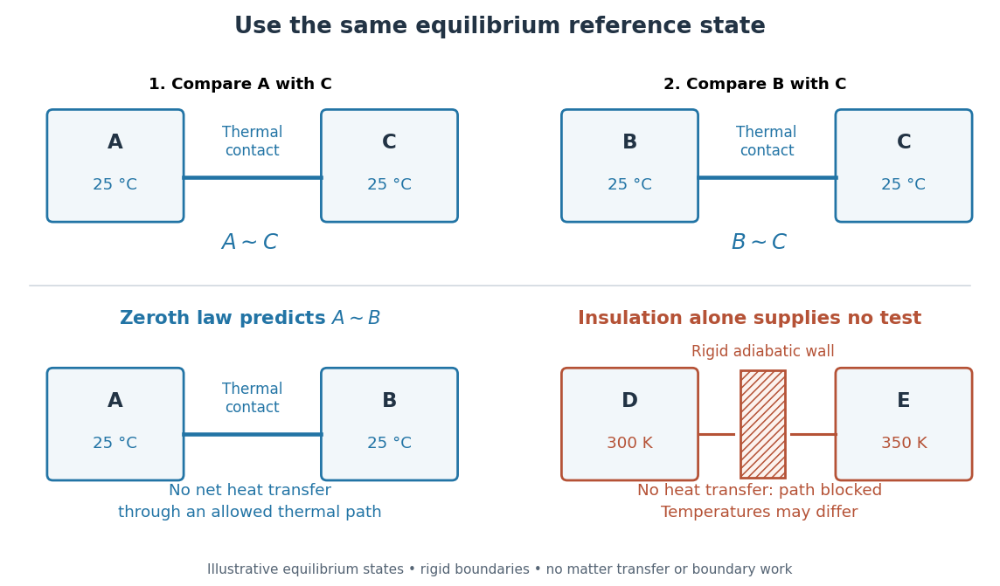

# Zeroth law of thermodynamics

↑ **Parent:** [Laws of thermodynamics](laws-of-thermodynamics.md)  
ⓦ [Wiki](https://en.wikipedia.org/wiki/Zeroth_law_of_thermodynamics)

If two [thermodynamic systems](thermodynamic-system.md) are each in [thermal equilibrium](thermal-equilibrium-split.md) with the same third system in the same equilibrium state, they are in [thermal equilibrium](thermal-equilibrium-split.md) with each other. Write $A\sim B$ for this relation. The [zeroth law of thermodynamics](zeroth-law-of-thermodynamics.md) supplies [transitivity](transitive-relation.md):

$$
A\sim C\quad\text{and}\quad B\sim C\quad\Longrightarrow\quad A\sim B.
$$

Its [symmetric relation](symmetric-relation.md) property and self-equilibrium ([reflexivity](reflexive-relation.md)), together with [transitivity](transitive-relation.md), make [thermal equilibrium](thermal-equilibrium-split.md) an [equivalence relation](equivalence-relation.md). Its [equivalence classes](equivalence-class.md) can be labelled by a common [empirical temperature](empirical-temperature.md); choosing an absolute numerical scale requires the further structure of [thermodynamic temperature](thermodynamic-temperature.md).[§4.1, printed pp. 109–110: thermal contact, transitivity and temperature labels](statistical-physics-by-david-tong/4-classical-thermodynamics.md)

The comparison assumes internally equilibrated macroscopic bodies, unchanged composition and mechanical constraints, and contact permitting only [heat](heat-split.md) exchange. Use rigid, impermeable [diathermal walls](diathermal-wall.md) so that neither matter transfer nor boundary [work](work.md) spoils the test. The same state of $C$ matters: letting $C$ warm while measuring $A$, then cool while measuring $B$, does not supply the premise. Ordinary nonrelativistic laboratory [thermodynamics](thermodynamics-split.md) is assumed; the [Tolman temperature law](tolman-ehrenfest-relation.md) treats gravitational qualifications. Equal [temperatures](temperature-split.md) establish the thermal condition, without requiring [mechanical equilibrium](mechanical-equilibrium.md) or [chemical equilibrium](chemical-equilibrium.md).

**[Figure 11](#zeroth-law-thermal-contact-comparison). Thermal equilibrium is transitive; an adiabatic wall supplies no equality test**. The top row compares $A$ and $B$ separately with the same equilibrium state of reference $C$. The lower left shows the predicted absence of net [heat transfer](heat-transfer.md) when $A$ and $B$ are put in [thermal contact](thermal-contact.md). The lower right is a counterexample to inferring equality from insulation: a rigid [adiabatic wall](adiabatic-wall.md) can separate bodies at different [temperatures](temperature-split.md). All numerical labels are illustrative.

This explains why a [thermometer](thermometer.md) can compare unlike materials: it supplies a reusable third system. A [temperature](temperature-split.md) is a property of an equilibrium state, while [heat](heat-split.md) is [energy](energy-split.md) transferred because of a [temperature](temperature-split.md) difference. Two bodies at the same [temperature](temperature-split.md) can have different [internal energies](internal-energy-split.md) and [heat capacities](heat-capacity.md). A [thermometer](thermometer.md) therefore does not measure a body's stored amount of [heat](heat-split.md); the finite-body disturbance and waiting-time calculations in [thermometer](thermometer.md) describe how making the comparison can change the state being measured.[§4.2, printed p. 111: heat as energy transfer, rather than a stored state quantity](statistical-physics-by-david-tong/4-classical-thermodynamics.md)

The name “zeroth” reflects logical order rather than the date of the first [thermometer](thermometer.md): this premise about [thermal equilibrium](thermal-equilibrium-split.md) precedes the already numbered [first law of thermodynamics](first-law-of-thermodynamics-split.md), [Second law of thermodynamics](second-law-of-thermodynamics-split.md) and [third law of thermodynamics](third-law-of-thermodynamics.md). This is the naming explanation given in [University Physics Volume 2 by Samuel J. Ling and others](university-physics-volume-2-by-samuel-j-ling-and-others.md) (§1.1, “Thermal Equilibrium”).[§1.1, paragraph introducing the zeroth law: retrospective numbering; the textbook credits the name to Ralph Fowler in the 1930s](university-physics-volume-2-by-samuel-j-ling-and-others.md)

The corresponding [Zeroth law of black-hole mechanics](zeroth-law-of-black-hole-mechanics.md) states constancy of [surface gravity](surface-gravity.md) over an equilibrium horizon; [Hawking radiation](hawking-radiation.md) identifies that quantity with physical temperature up to its universal conversion factor.

**Table of contents**

- [Thermal contact](thermal-contact.md)
  - [Diathermal wall](diathermal-wall.md)
  - [Adiabatic wall](adiabatic-wall.md)
- [Empirical temperature](empirical-temperature.md)
- [Zeroth-law thermometer comparison](zeroth-law-thermometer-comparison.md)
  - [Two-point thermometer calibration example](two-point-thermometer-calibration-example.md)
  - [Reference-bath thermometer comparison](reference-bath-thermometer-comparison.md)

## ↑ Ancestors (6)

1. [Laws of thermodynamics](laws-of-thermodynamics.md)
2. [Thermodynamics](thermodynamics-split.md)
3. [Statistical physics](statistical-physics-split.md)
4. [Branches of physics](branches-of-physics.md)
5. [Physics](physics-split.md)
6. [Codex Wiki](split.md)

## ← Incoming links (12)

- [Diathermal wall](diathermal-wall.md)
- [Empirical temperature](empirical-temperature.md)
- [Laws of thermodynamics](laws-of-thermodynamics.md)
- [Solution](past-exam-of-the-mathematics-course-of-the-university-of-cambridge/2004/iii/paper-57/1/solution.md)
- [Solution](past-exam-of-the-mathematics-course-of-the-university-of-cambridge/2009/iii/paper-56/4/b/solution.md)
- [Solution](past-exam-of-the-physics-b-course-of-the-university-of-cambridge/2010/paper-1/section-c/c13/solution.md)
- [Solution](past-exam-of-the-physics-b-course-of-the-university-of-cambridge/2019/paper-2/section-c/c13/solution.md)
- [Reference-bath thermometer comparison](reference-bath-thermometer-comparison.md)
- [Temperature](temperature-split.md)
- [Thermal equilibrium](thermal-equilibrium-split.md)
- [Zeroth law of thermodynamics](zeroth-law-of-thermodynamics.md)
- [Zeroth-law thermometer comparison](zeroth-law-thermometer-comparison.md)
