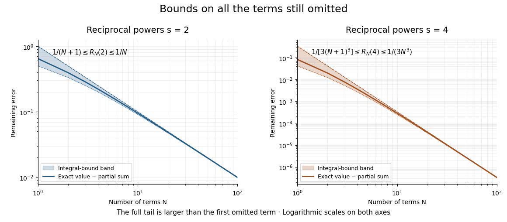

# Zeta series truncation error

↑ **Parent:** [Euler evaluation of even zeta values](euler-evaluation-of-even-zeta-values.md)

For a real [exponent](exponent.md) $s>1$ and a [positive integer](positive-integer.md) $N$, the [series truncation error](series-truncation-error.md) in the defining [Riemann zeta function](riemann-zeta-function.md) [series](series-mathematics.md) is

$$
R_N(s)=\sum_{n=N+1}^{\infty}n^{-s}>0.
$$

The [integral comparison](integral-comparison-for-a-nonincreasing-nonnegative-function.md) for the positive decreasing [function](function-split.md) $x^{-s}$ gives the explicit bounds

$$
\boxed{\frac{(N+1)^{1-s}}{s-1}\leq R_N(s)\leq\frac{N^{1-s}}{s-1}}.
$$

On each unit [interval](interval-mathematics.md), the area under $x^{-s}$ lies between its endpoint heights. Summing from the first omitted term gives the lower [integral](integral-split.md) from $N+1$ to infinity and the upper [integral](integral-split.md) from $N$ to infinity. This uses positivity and monotonicity, not an assumption that the last computed term equals the remaining error.

At $N=10$, the bounds are $1/11\leq R_{10}(2)\leq1/10$, whereas $1/(3\cdot11^3)\leq R_{10}(4)\leq1/(3\cdot10^3)$. The errors above fit both intervals. Merely looking at the eleventh term would give $1/121\approx0.008264$ for squares, far smaller than the actual remaining $0.095166$.

**[Figure 4](#image-integral-bounds-enclose-the-full-remaining-error-of-two-zeta-series). Integral bounds enclose the full remaining error of two zeta series**. Original computed errors, obtained by subtracting finite [partial sums](partial-sum.md) from the exact even zeta values. Shaded bands show the upper and lower [integral comparison](integral-comparison-for-a-nonincreasing-nonnegative-function.md) bounds. The logarithmic axes reveal decay proportional to $1/N$ for squares and $1/N^3$ for fourth powers. These are mathematical computations, not measured data.

For a chosen absolute error target $\varepsilon>0$, the sufficient condition is $N\geq((s-1)\varepsilon)^{-1/(s-1)}$, rounded upward to an [integer](integer-split.md). Thus $\varepsilon=10^{-4}$ requires $N=10000$ by this bound for squares but only $N=15$ for fourth powers. This is a guarantee from an upper bound, not a claim that those are the smallest successful term counts.

## ↑ Ancestors (6)

1. [Euler evaluation of even zeta values](euler-evaluation-of-even-zeta-values.md)
2. [Bernoulli number](bernoulli-number-split.md)
3. [Number theory](number-theory-split.md)
4. [Area of mathematics](area-of-mathematics.md)
5. [Mathematics](mathematics-split.md)
6. [Codex Wiki](split.md)

## ← Incoming links (2)

- [Basel problem](basel-problem.md)
- [Series truncation error](series-truncation-error.md)
