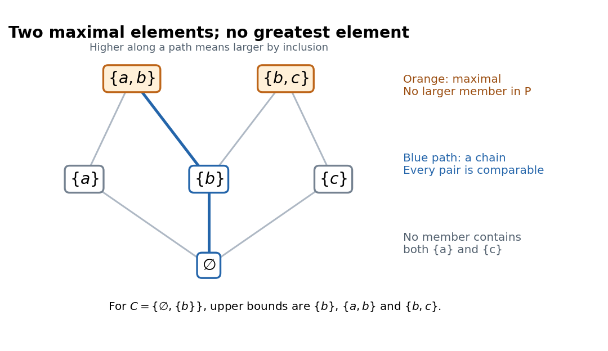

<h1 id="zorn-s-lemma-in-a-finite-poset">Zorn's lemma in a finite poset</h1>

↑ **Parent:** [Zorn's lemma](zorn-s-lemma.md)

Consider the following [finite set](finite-set.md) of [subsets](subset.md), ordered by [subset](subset.md) containment:

$$
P=\{\varnothing,\{a\},\{b\},\{c\},\{a,b\},\{b,c\}\}.
$$

Every nonempty [chain in a partial order](chain-in-a-partial-order.md) has a [greatest element](greatest-element.md) within that [chain in a partial order](chain-in-a-partial-order.md), hence an [upper bound](upper-bound-in-a-partially-ordered-set.md) in $P$. For the empty [chain in a partial order](chain-in-a-partial-order.md), choose $\varnothing\in P$. Thus the hypothesis of [Zorn's lemma](zorn-s-lemma.md) holds. The two [maximal elements](maximal-element-of-a-partially-ordered-set.md) are $\{a,b\}$ and $\{b,c\}$: neither is a proper [subset](subset.md) of another member of $P$. There is no [greatest element](greatest-element.md), because it would have to contain both, and no member of $P$ contains $\{a,b,c\}$.

**[Figure 3](#image-a-finite-inclusion-poset-with-two-maximal-elements-and-no-greatest-element). A finite inclusion poset with two maximal elements and no greatest element**. Lines show immediate upward inclusions; following upward paths gives all other strict comparisons. The blue path is a chain, and the orange nodes are the two maximal elements.

For the [chain in a partial order](chain-in-a-partial-order.md) $C=\{\varnothing,\{b\}\}$, the member $\{b\}$ is already an [upper bound](upper-bound-in-a-partially-ordered-set.md), although it is not a [maximal element](maximal-element-of-a-partially-ordered-set.md) of $P$. Both orange members are also [upper bounds](upper-bound-in-a-partially-ordered-set.md) for $C$. A [chain in a partial order](chain-in-a-partial-order.md) need not have a unique [upper bound](upper-bound-in-a-partially-ordered-set.md), and the [upper bound](upper-bound-in-a-partially-ordered-set.md) used to check the hypothesis need not be the eventual [maximal element](maximal-element-of-a-partially-ordered-set.md).

The restriction to [chains in a partial order](chain-in-a-partial-order.md) matters. The [subset](subset.md) $\{\{a\},\{c\}\}\subseteq P$ has no [upper bound](upper-bound-in-a-partially-ordered-set.md) in $P$, but its two members are incomparable, so it is not a [chain in a partial order](chain-in-a-partial-order.md). Requiring every [subset](subset.md) of $P$ to have an [upper bound](upper-bound-in-a-partially-ordered-set.md) would be much stronger: taking that [subset](subset.md) to be $P$ itself would force a [greatest element](greatest-element.md).

## ↑ Ancestors (6)

1. [Zorn's lemma](zorn-s-lemma.md)
2. [Set theory](set-theory-split.md)
3. [Foundations of mathematics](foundations-of-mathematics-split.md)
4. [Area of mathematics](area-of-mathematics.md)
5. [Mathematics](mathematics-split.md)
6. [Codex Wiki](split.md)
